# exo-v2v — warm migration of VMware vSphere VMs to Exoscale

> [!WARNING]
> **Experimental.** exo-v2v 0.5.0 is an early release, validated in one lab (ESXi 7.0 U3 to Exoscale ch-gva-2). Try it on non-critical VMs first; commands and behaviour may change.

`exo-v2v` moves a running VMware VM to an Exoscale Compute instance with a
downtime of minutes, regardless of disk size:

1. **Replicate while the VM runs.** The VM's disks are copied to their final
   Exoscale disks, then kept in sync with VMware Changed Block Tracking (CBT):
   each cycle copies only what changed since the previous one.
2. **Cut over.** The VM is shut down, the last changes are copied, the guest is
   converted for KVM *on the target instance itself* (`virt-v2v-in-place`), and
   the instance boots the migrated OS from its own disks.

No VDDK, no vSphere plugin, no agent inside the guest, no staging storage.



## What it handles

| Area | Supported |
|---|---|
| Guests | Linux (Ubuntu, Debian, RHEL family) and Windows Server 2022/2025, BIOS or UEFI, Secure Boot, vTPM ([details](docs/supported-os.md)) |
| Disks | Several VMDKs per VM on SCSI, SATA or NVMe controllers; the system disk is found from the boot order or VMware Tools; up to 5 data disks as Block Storage volumes |
| **VMDK chains** | VMs running on snapshot deltas, at any depth. Snapshots may be taken, deleted or reverted during replication: a revert makes the next cycle copy the allocated areas again |
| Disks that change | A disk grown during replication is followed (its volume is resized; a grown system disk resets the target instance); a disk added is replicated to a new volume |
| LVM | Volume groups spread over several disks. A disk that extends the system disk's volume group is carried inside the root disk; logical volumes on data disks are rebuilt for 4 KiB sectors when their filesystem needs it, with the same UUIDs |
| Filesystems | ext, XFS (including 512-byte-sector XFS, the RHEL default on VMware), NTFS, swap; partition tables GPT and MBR |
| Replication | Changed Block Tracking, VDDK-free, through a replication appliance in vSphere; several migrations at once from one appliance |
| **Applications** | A [group](docs/groups.md) of VMs (load balancer, application servers, databases) replicated together and cut over in one window: stopped front to back, converted in parallel, started back to front with health checks, rolled back as a whole |
| Networks | Each vSphere port group maps to the public interface or an Exoscale private network; VMs keep their private addresses, the guest's network configuration follows the new NICs |
| **Rehearsal** | Copies of the VMs started from their replicas, converted as at cutover, [**airgapped**](docs/rehearsal.md) (no public IP, isolated networks, no router) and reachable only by SSH through a relay; health checks, a predicted cutover window, the outside names the copies tried to resolve; the sources and replication carry on |
| Status page | A read-only [web page](docs/web.md) on the appliance with every migration and group |
| vCenter | VMs by name, inventory path or UUID; groups from a [folder or a tag](docs/vcenter.md); `plan` checks the account's privileges, the appliance's datastores and DRS |
| Unattended | Replication on systemd timers, [webhook alerts](docs/OPERATIONS.md#unattended-timers-and-alerts) (failing or lagging replication, a target that restarted, cutovers); a target that restarts boots nothing and is recovered with one command |
| Not supported | Independent disks, raw device mappings, encrypted disks, Windows dynamic disks and Storage Spaces as data disks ([limitations](docs/limitations.md)) |

## Documentation

Read it at **https://retrack.github.io/exo-v2v/**, or in [`docs/`](docs/):

| Page | What it covers |
|---|---|
| [How it works](docs/concepts.md) | The replication appliance, sync cycles, cutover, guest adaptation, security model |
| [Prerequisites](docs/prerequisites.md) | vSphere privileges, the appliance, network flows, Exoscale account |
| [vCenter](docs/vcenter.md) | The role, folders and tags, where the appliance runs, DRS |
| [IAM role](docs/iam.md) | A least-privilege Exoscale role for the appliance's API key |
| [Receiver templates](docs/receiver-templates.md) | Templates that boot straight into the receiver: faster `create`, no mirror access |
| [Supported operating systems](docs/supported-os.md) | Tested and expected-to-work guests |
| [Limitations](docs/limitations.md) | Known limits and their workarounds |
| [Moving an application](docs/groups.md) | Groups: the manifest, private networks, the coordinated cutover, rollback |
| [Rehearsal](docs/rehearsal.md) | Airgapped copies of the VMs to check before the cutover |
| [Web status page](docs/web.md) | The read-only status page and its API |
| [Operations runbook](docs/OPERATIONS.md) | Step-by-step migration, rollback, troubleshooting |
| [Architecture](docs/ARCHITECTURE.md) | Design details for contributors |
| [Project status](docs/status.md) | What is tested, and what it takes to drop the "Experimental" label |

## Requirements

| Where | What |
|---|---|
| vSphere | vCenter or standalone ESXi 6.7+ (tested: ESXi 7.0 U3). An account allowed to snapshot the source VM and reconfigure the appliance VM (add/remove disk). |
| Replication appliance | A Linux VM **in the same vSphere environment**, on a host that sees the source VM's datastores (hot-add transport, the same mechanism backup products use). Python ≥ 3.10, `ssh`, the [`exo` CLI](https://github.com/exoscale/cli) ≥ 1.102, a free paravirtual SCSI slot. Runs `sync`/`cutover` as **root**. Outbound TCP 22 to Exoscale, 443 to vCenter/ESXi. |
| Exoscale | An API key restricted to Compute (instances, Block Storage, security groups, private networks, anti-affinity groups) in the `exo` CLI config (or `EXOSCALE_API_KEY`/`EXOSCALE_API_SECRET`); see [IAM role](docs/iam.md). |
| Source VM | Linux or Windows Server ([supported operating systems](docs/supported-os.md)); BIOS or UEFI, with or without Secure Boot; disks on SCSI, SATA or NVMe controllers, up to 5 data disks as Block Storage volumes; snapshot chains are fine; no independent/RDM disks. CBT is enabled automatically. VMware Tools running at `plan` time helps it map the disks. |

## Install

```bash
pipx install https://github.com/retrack/exo-v2v/releases/download/v0.5.0/exo_v2v-0.5.0-py3-none-any.whl
# or from source: pipx install git+https://github.com/retrack/exo-v2v@v0.5.0   (pulls pyvmomi)
exo config                          # Exoscale credentials for the exo CLI
export VSPHERE_HOST=vcenter.example VSPHERE_USER=migration@vsphere.local VSPHERE_PASSWORD=…
```

## Quickstart

```bash
exo-v2v plan    web01 --vm web01 --zone ch-gva-2 --security-group web
exo-v2v create  web01                   # receiver instance + volumes: ~1 min with a receiver template, 5-15 min without
sudo -E exo-v2v sync web01              # first cycle = full copy (VM keeps running)
sudo -E exo-v2v sync web01 --every 900  # keep it fresh until the maintenance window (Ctrl-C)
sudo -E exo-v2v cutover web01           # downtime starts here
exo-v2v status  web01
exo-v2v cleanup web01                   # after you validated the workload
```

`plan` prints everything it will do and refuses unsupported VMs; nothing is
created before `create`. Every step is idempotent and resumable; state lives in
`~/.exo-v2v/<name>/` (`EXO_V2V_HOME` to move it).

### Move an application

```bash
exo-v2v group discover shop --vm lb01 --vm app01 --vm app02 --vm db01 --zone ch-gva-2   # draft shop.yaml
exo-v2v group plan    shop -f shop.yaml   # tiers, networks, health checks, hooks: every member planned
exo-v2v group create  shop                # private networks (addresses kept), anti-affinity, receivers
sudo -E exo-v2v group sync shop --every 900
sudo -E exo-v2v group rehearse shop       # airgapped copies to check first, through a relay
exo-v2v rehearsal destroy shop
sudo -E exo-v2v group cutover shop        # stop front to back, convert in parallel, start back to front
sudo -E exo-v2v web                       # read-only status page on 127.0.0.1:8780
```

See [Moving an application](docs/groups.md), [Rehearsal](docs/rehearsal.md) and [Web status page](docs/web.md).

## What cutover does

1. Shuts the VM down (guest shutdown via VMware Tools, hard power-off after
   `--shutdown-timeout`), copies the final changes. *(`--verify` additionally
   hash-compares source and target disks.)*
2. Windows: uses the virtio-win drivers that `create` staged on the receiver.
3. `virt-v2v-in-place` on the receiver: virtio drivers, initramfs, removal of
   VMware Tools, bootloader fixes — using nested KVM on the receiver.
4. **Exoscale-specific fix-ups** (see below), relayout of incompatible volumes.
5. Restarts the instance from its own disks, scales it to the target type,
   attaches your security groups, waits for SSH (Linux) / RDP (Windows).
   Windows then finishes driver installation on its own for a few minutes (it may
   reboot); data disks come online at the end of that.

`rollback` powers the source VM back on and stops the instance; the source is
never modified by the migration (snapshots are removed after every cycle).

## Exoscale-specific fix-ups (automatic)

| Issue | Why | What exo-v2v does |
|---|---|---|
| Network config bound to VMware NIC names/MACs (`ens192`, `ens224`, HWADDR) | Debian/Ubuntu/RHEL configs name the vmxnet3 interface; on Exoscale the NIC is `ens3`/`eth0` | Installs `v2v-netfix.service` (first boot, before networking): maps stale names to present NICs in ifupdown/netplan/NetworkManager/ifcfg, drops VMware MAC pins, DHCP fallback |
| **Block Storage volumes have 4096-byte sectors** (the root disk has 512) | Partition tables written for 512-byte sectors are invisible on 4Kn; XFS with `sectsz=512` (the RHEL default on VMware) and ext 1K-block filesystems refuse to mount; Windows shows 512-byte-sector NTFS volumes as RAW | GPT/MBR are rescaled in place (the Windows MSR at LBA 34 is realigned). **NTFS**: the boot sector geometry is rewritten for 4096-byte sectors in place — no data moves (needs ≥ 4 KiB clusters, the default); original boot sector kept for revert. **XFS-512 / ext-1K**, as partitions or LVM logical volumes: rebuilt onto fresh 4K volumes with the **same UUIDs, labels and partition GUIDs** (and the same PV/VG/LV identifiers: a volume group spread over several volumes is rebuilt across new ones), so `fstab` keeps working; the original volumes are kept, detached, as rollback copies (adds cutover time proportional to the data). **A disk that shares a filesystem with the system disk** (a root volume group extended onto a second VMDK) is carried inside the root disk, which keeps 512-byte sectors. |
| SELinux guests | injected files need labels | labelled at injection; no relabel reboot |
| Windows: data disks come up **Offline** | Windows Server's SAN policy (`OfflineShared`) keeps "new" disks offline — after the move to virtio every data volume is new | A first-boot script (in virt-v2v's own firstboot framework) registers a SYSTEM task that sets the policy to `OnlineAll` and brings the disks online, retrying until the storage services answer, then removes itself |

## Validation

Live migrations from ESXi 7.0 U3 to ch-gva-2 (VM running during replication):

| Guests | Result | Downtime |
|---|---|---|
| Ubuntu 24.04, AlmaLinux 9, Debian 13, BIOS and UEFI (6 migrations, run concurrently from one appliance) | 6/6 | 120–347 s |
| Windows Server 2022, BIOS and UEFI, NTFS data volume | 2/2 | 420–471 s |
| Ubuntu 24.04 and Windows Server 2022, UEFI with Secure Boot (Secure Boot on after migration) | 2/2 | 133–455 s |
| With receiver templates: the 6 Linux guests above, Windows Server 2022 and 2025 (BIOS and UEFI), up to 8 concurrent | 10/10 | 136–513 s |
| Debian 13 under continuous write load (3 delta cycles) | pass | 298 s |
| AlmaLinux 9, 4 disks on paravirtual SCSI + NVMe, XFS-512 logical volume spanning two disks (rebuilt across two new volumes), with and without a receiver template | 2/2 | 9–10 min¹ |
| AlmaLinux 9 with its root volume group extended onto a second disk (carried inside the root disk), on a 3-level snapshot chain; during replication: snapshot deleted, snapshot reverted, data disk grown, system disk grown, disk hot-added | pass | 9 min¹ |
| A group of 10 VMs on 18 disks (55 GB: AlmaLinux 9 with LVM spans and a snapshot chain, Debian 13, Ubuntu 24.04, Windows Server 2022 and 2025), one appliance with 4 vCPU | full copy 15 min, delta round 2 min; rehearsal of 8; group cutover: pass | window 803 s |
| A group: HAProxy (Debian 13, 2 NICs), 2 application servers (AlmaLinux 9, Ubuntu 24.04), PostgreSQL (AlmaLinux 9, XFS-512 data disk), plus a Windows Server 2022 member; static private addresses kept on a private network | 3 coordinated cutovers: pass; a conversion failure stopped the group and `group rollback` restored it on VMware; the group process killed mid-cutover, then resumed | window 461–486 s |

¹ Without `--verify`; these runs used it (every disk hash-compared before conversion, about 13–15 more minutes on the lab's HDD datastore).



## Limits

- 1 root disk + up to 5 data volumes per instance; root disk ≥ 10 GB. Disks
  carried inside the root disk (`--fold`) do not count.
- A single migration gets one public NIC. In a [group](docs/groups.md), each port group maps to
  the public interface or an Exoscale managed private network (addresses kept); no Elastic IPs, no VPC yet.
- Windows data volumes must use NTFS clusters ≥ 4 KiB (the default); smaller
  clusters cannot be expressed in 4096-byte sectors. Windows **dynamic disks**
  and Storage Spaces disks are not supported as data disks (detected, left
  untouched, unreadable on Exoscale): convert them to basic disks first.
- Disks may grow or be added during replication; a removed disk stops `sync`.
- If the receiver restarts during the sync window, nothing boots (its boot
  sectors stay off the disk until the conversion) and `sync` says so:
  `exo-v2v recover NAME` resets its root disk; the next sync copies the system
  disk again and only the changes of the data volumes.

The complete list is in [Limitations](docs/limitations.md). See the
[operations runbook](docs/OPERATIONS.md) for troubleshooting.

## License and trademarks

Apache License 2.0, the license of the [Exoscale CLI](https://github.com/exoscale/cli). See [LICENSE](LICENSE) and [NOTICE](NOTICE).
exo-v2v is provided "as is", without warranties or conditions of any kind.

VMware, vSphere, vCenter, ESXi and the other VMware product names are trademarks or registered
trademarks of Broadcom Inc. and/or its subsidiaries in the United States and other countries.
exo-v2v is not affiliated with, sponsored, endorsed or supported by Broadcom or VMware. It contains
no VMware software (it uses the public vSphere APIs through pyVmomi), and you need your own valid
licences for the VMware products you migrate from. All other trademarks are the property of their
respective owners. See [Trademarks and licences](docs/legal.md).
