# How exo-v2v works

> **Experimental.** exo-v2v 0.6.0 is an early release, validated in one lab (ESXi 7.0 U3 to Exoscale ch-gva-2). Try it on non-critical VMs first; commands and behaviour may change.

exo-v2v moves a running VMware vSphere virtual machine to an Exoscale Compute
instance. The VM keeps running while its disks are copied. It is stopped only
for the final cutover, which took 2 to 9 minutes in our tests, whatever the
size of the disks.

## The parts

| Part | Where it runs | What it does |
|---|---|---|
| **exo-v2v** (CLI) | The *replication appliance*, a small Linux VM you deploy in the same vSphere environment as the VMs to migrate | Plans the migration, creates the Exoscale resources, copies the disks, drives the cutover |
| **Target instance** | Your Exoscale zone | The instance that will run the migrated VM. During the migration it runs a temporary agent *from memory*, so its own disks can be overwritten. It starts either from a [receiver template](receiver-templates.md) that boots straight into memory (about 1 minute) or from a stock Linux template that installs the tools first (5 to 15 minutes) |
| **Root disk and Block Storage volumes** | Attached to the target instance | Receive the VM's disks: the system disk becomes the instance's root disk, the others become Block Storage volumes (see [The VM's disks](#the-vms-disks)) |

There is no intermediate copy: the data lands directly on the disks the
migrated VM boots from.

## Replicating while the VM runs

exo-v2v uses VMware Changed Block Tracking (CBT), the mechanism backup products
use. Each *sync cycle* copies only what changed since the previous one.

1. A short-lived VM snapshot freezes the disks at a point in time.
2. vSphere reports which areas changed since the last cycle. The first cycle
   copies every allocated area.
3. The frozen disk is attached **read-only** to the appliance (*hot-add*),
   together with the snapshot deltas below it when the VM already runs on a
   chain of snapshots, so the appliance sees the disk exactly as the VM does. It
   reads the changed areas and writes them to the target instance through an
   SSH tunnel.
4. The target instance records the cycle's change ID; the snapshot is deleted.

No VMware software development kit (VDDK) is needed, and nothing is installed
inside the VM. Run `exo-v2v sync NAME --every 900` to start a cycle every 15 minutes until
your maintenance window.

## The VM's disks

A VM can have several virtual disks (VMDKs), on SCSI, SATA or NVMe
controllers, and each disk can be a chain of snapshot deltas. `exo-v2v plan`
maps each of them:

| VM disk | On Exoscale |
|---|---|
| The system disk | The instance's root disk. exo-v2v finds it from the VM's boot order, then from VMware Tools (the disk holding `/boot` or `C:\`), then from `bios.hddOrder`. If none of these answers, `plan` warns that it guessed; `--system-disk` sets it. |
| Other disks | One Block Storage volume each, up to 5 |
| A disk that shares a filesystem with the system disk, such as a root volume group extended onto a second VMDK (Linux) | Carried *inside* the root disk: replicated into a region after the system disk, then added as a partition of the root disk at cutover. A 4096-byte-sector volume cannot hold part of a volume group whose filesystem only works with 512-byte sectors. `plan` detects it with VMware Tools; `--fold DISK` forces it, `--no-fold` turns it off. |

Snapshots and changes during replication:

- **Existing snapshots.** A VM that runs on a chain of snapshot deltas is
  replicated as it is: each cycle reads the disks as the VM sees them. Deleting
  snapshots during replication is fine. Reverting to a snapshot resets CBT:
  the next cycle copies the allocated areas of every disk again.
- **A disk grows.** The next cycle resizes its Block Storage volume (detach,
  resize, attach) and copies the disk again. When the system disk, or a disk
  carried inside it, grows beyond the root disk, the target instance is reset
  with a bigger root disk and its agent restarted. Its volumes are kept, and
  only the root disk is copied again.
- **A disk is added.** The next cycle creates a volume for it and copies it.
- **The target instance restarts** (by hand, or on the platform's side). It
  boots nothing: the boot sectors of the system disk stay off the disk until the
  conversion, so an unconverted copy of the source never runs next to it, and
  its security group lets nothing out before the cutover. `sync` reports it;
  `exo-v2v recover NAME` resets the root disk to the receiver template, and the
  next cycle copies the system disk again and only the changes of the volumes.
- **A disk is removed.** `sync` stops: plan the migration again.

## The migration lifecycle

| Step | Command | The source VM |
|---|---|---|
| Check the VM and size the instance | `exo-v2v plan` | Untouched |
| Create the target instance and volumes | `exo-v2v create` | Untouched |
| First copy, then keep it fresh | `exo-v2v sync [--every SECONDS]` | Running |
| Switch over | `exo-v2v cutover` | Shut down: **downtime starts** |
| Validate, then close the migration | `exo-v2v cleanup` | Off, kept until you delete it |

Every step can be repeated or resumed after an interruption. Until
`cleanup`, `exo-v2v rollback` powers the source VM back on and stops the
Exoscale instance.

## What happens at cutover

1. The VM is shut down through VMware Tools (or powered off after a timeout),
   and the last changes are copied.
2. The guest is converted for the KVM hypervisor *on the target instance
   itself*, with `virt-v2v-in-place`: virtio drivers, boot loader and initramfs,
   removal of VMware Tools.
3. exo-v2v adapts the guest to Exoscale (see below).
4. The instance restarts from its own disks, is scaled to its final instance
   type, receives your security groups, and exo-v2v waits until SSH (Linux) or
   RDP (Windows) answers.

Downtime is the sum of the shutdown, the last delta, the conversion (2 to 5
minutes) and the boot. Run a sync shortly before the cutover so that the last
delta is small. Measured values per guest are in
[Supported operating systems](supported-os.md).

## Adapting the guest to Exoscale

These adjustments are automatic:

| Difference | What exo-v2v does |
|---|---|
| Network interfaces get new names and MAC addresses | A first-boot service maps the old interface names in the network configuration to the new ones, removes VMware MAC pinning, and falls back to DHCP. In a group it follows a map by MAC address: a static address moves to the private network NIC that keeps it, the public interface gets DHCP |
| Block Storage volumes use 4096-byte sectors; VMware disks use 512 | Partition tables are rewritten for 4096-byte sectors. NTFS volumes are adapted in place. XFS and ext filesystems that only work with 512-byte sectors are rebuilt on a new volume with the same identifiers, as partitions or as LVM logical volumes (a volume group spread over several volumes is rebuilt across new ones, with the same LVM identifiers). The original volumes are kept as rollback copies |
| Windows keeps new disks offline | A first-boot task sets the SAN policy to `OnlineAll` and brings the data disks online |
| Secure Boot and TPM | The instance is created with Secure Boot and a TPM when the source VM has them |
| SELinux guests | Files exo-v2v adds are labelled correctly, so no relabelling reboot is needed |

## Applications

A [group](groups.md) moves several VMs as one application. Each member is an
ordinary migration; the group adds a manifest (tiers, networks, health checks,
hooks), private networks that keep the VMs' addresses, and a coordinated
cutover: the tiers stop front to back, every member converts in parallel, and
the tiers start back to front, each after the previous one passes its health
checks. `group rollback` brings the whole application back on VMware.

## Rehearsals

A [rehearsal](rehearsal.md) starts copies of the replicated VMs, converted as
the cutover would convert them, on isolated networks without a public IP or a
router, reachable only by SSH through a relay. It checks the application before
the window without touching the sources, the replication or anything the
application talks to in production.

## Security model

- The appliance needs an Exoscale API key limited to Compute (see
  [IAM role](iam.md)) and a vSphere account allowed to snapshot the VMs.
- Each migration gets its own SSH key and its own security group. That group
  opens TCP 22 only, and only to the appliance's public address. No other
  port is exposed during replication.
- In a group, each member's own security group also opens its health check
  ports to the appliance only, until `cleanup`.
- The data stream runs inside SSH. The agent's disk export and control API
  listen on the instance's loopback interface only.
- Snapshots are read through a read-only attachment; exo-v2v never writes to
  the source VM's disks.
