# Moving an application (groups)

> **Experimental.** exo-v2v 0.4.1 is an early release, validated in one lab (ESXi 7.0 U3 to Exoscale ch-gva-2). Try it on non-critical VMs first; commands and behaviour may change.

A group moves several VMs that work together, for example a load balancer, a
few application servers and a database, as one unit. Every VM is replicated
while it runs, like a single migration. The cutover is coordinated: one
maintenance window, the VMs stopped and started in a set order, health checks
between the steps, and one command to bring the whole application back on
VMware if something fails.



## What a group adds

| Feature | What it does |
|---|---|
| Order | Tiers: tier 1 is the back end (databases), higher tiers are closer to the users. The cutover stops the highest tier first and starts tier 1 first |
| Downtime | Each VM's final copy and conversion start as soon as that VM is off, and the conversions run in parallel: the window is close to the slowest member's downtime, not the sum |
| Private addresses | A vSphere port group maps to an Exoscale managed private network. Each VM keeps its address there (a static lease), so configurations that name other servers by IP keep working |
| Health checks | TCP, HTTP or a command, run from the appliance after each tier starts. The next tier starts only when the checks pass |
| Hooks | Commands run on the appliance before the first VM stops and after the last tier is healthy (maintenance page, DNS switch) |
| Placement | Anti-affinity groups keep VMs such as the two application servers on different hypervisors |
| Rollback | `group rollback` stops the Exoscale instances and powers the sources on, back end first |
| Resume | The cutover records every step. If the appliance or the command stops, `group cutover` again continues where it stopped |

Members are ordinary migrations named `GROUP-VM` (`shop-db01`): `exo-v2v status`
and the [web status page](web.md) show them, and their logs are in
`~/.exo-v2v/groups/GROUP/logs/`.

## Commands

```bash
exo-v2v group discover shop --vm lb01 --vm app01 --vm app02 --vm db01 --zone ch-gva-2   # draft shop.yaml
vi shop.yaml                                     # tiers, security groups, health checks, hooks
exo-v2v group plan     shop -f shop.yaml         # every member's plan + the cutover runbook
exo-v2v group create   shop                      # private networks, anti-affinity groups, receivers
sudo -E exo-v2v group sync shop                  # a cycle on every member, in parallel
sudo -E exo-v2v group sync shop --every 900      # keep them fresh until the window
sudo -E exo-v2v group rehearse shop              # airgapped copies to check first (optional)
exo-v2v rehearsal destroy shop
sudo -E exo-v2v group cutover shop               # the window
exo-v2v group status   shop
sudo -E exo-v2v group rollback shop              # if needed: back on VMware
exo-v2v group cleanup  shop                      # after validation
```

`group plan` checks every VM as `plan` does, plus the group: every port group
mapped, no address used twice, security groups present, instance and private
network quotas. Nothing is created before `group create`.

## The manifest

`group discover` writes a draft from vSphere: one network per port group, with
the addresses VMware Tools reports. A port group that carries the default route
of a VM with several NICs is taken for the front end (the public interface).
Check every line.

```yaml
name: shop
zone: ch-gva-2

defaults:                               # any per-VM key, for every VM
  receiver_template: exo-v2v-linux-legacy
  receiver_template_visibility: private

networks:                               # vSphere port group -> Exoscale
  front:
    source: pg-front
    type: public                        # the instance's public interface (DHCP)
  app:
    source: pg-app
    type: private                       # a managed private network, v2v-shop-app
    cidr: 10.20.0.0/24
    keep_addresses: true                # static leases = the VMs' current addresses

security_groups:                        # created by `group create` when missing
  v2v-shop-web: [tcp/80 0.0.0.0/0, tcp/443 0.0.0.0/0]
  v2v-shop-closed: []                   # no ingress at all

anti_affinity:
  app: [app01, app02]                   # different hypervisors (set at creation)

vms:
  - vm: db01
    tier: 1                             # started first, stopped last
    security_groups: [v2v-shop-closed]
    health: {tcp: 5432}
  - vm: app01
    tier: 2
    security_groups: [v2v-shop-closed]
    health: {http: "http://{public_ip}:8080/health", expect: ok}
  - vm: app02
    tier: 2
    security_groups: [v2v-shop-closed]
    health: {http: "http://{public_ip}:8080/health", expect: ok}
  - vm: lb01
    tier: 3                             # stopped first, started last
    security_groups: [v2v-shop-web]
    health: {http: "http://{public_ip}/", expect: "beats"}
    name: lb01                          # renamed at cleanup (default: v2v-shop-lb01)

hooks:
  pre_cutover: ./maintenance-page.sh on
  post_cutover: ./switch-dns.sh {lb01.public_ip}

cutover:
  parallel: 8                           # member cutovers at a time
  max_window: 30m                       # stop when exceeded
  rollback_on_failure: false            # true: roll back on any failure
  health_timeout: 10m
  max_sync_age: 6h                      # members must have synced this recently

rehearsal:                              # see Rehearsal
  access: [203.0.113.0/24]
  ssh_keys: [ssh-ed25519 AAAA... alice@example.com]
  ttl: 8h
```

| Key | Meaning |
|---|---|
| `networks.NAME.source` | A vSphere port group. Every NIC of every member must be on a mapped port group |
| `networks.NAME.type` | `public`: the instance's public interface, DHCP. `private`: an Exoscale managed private network |
| `networks.NAME.cidr` | The subnet of a private network. The top host address (`.254` of a /24) belongs to Exoscale's DHCP server: a VM using it must be renumbered |
| `networks.NAME.exoscale_name` | An existing private network to use instead of creating `v2v-GROUP-NAME` (the appliance role only attaches `v2v-*` networks) |
| `vms[].tier` | 1 = back end. Members of a tier stop and start together |
| `vms[].ip` | `{NETWORK: ADDRESS}` when VMware Tools do not report the address |
| `vms[].security_groups` | Attached at cutover. Existing groups, or ones defined under `security_groups:` |
| `vms[].health` | `tcp: PORT`, `http: URL` (2xx/3xx, optional `expect: TEXT` in the body), `command: SHELL` (exit 0), `timeout` |
| `vms[].name` | The instance's final name, applied by `group cleanup` |
| `vms[]` other keys | As the `plan` options: `instance_type`, `system_disk`, `receiver_template`, `receiver_template_visibility`, `fold`, `no_fold` |

Placeholders in health checks and hooks: `{public_ip}`, `{private_ip}`,
`{ip.NETWORK}` (the member's own), and `{VM.public_ip}`, `{VM.private_ip}`,
`{VM.ip.NETWORK}` for any member. Hooks also get `V2V_GROUP`, `V2V_STEP` and
`V2V_<VM>_PUBLIC_IP` / `V2V_<VM>_PRIVATE_IP` in their environment, and run in
the manifest's directory.

## Networks

Each Exoscale instance gets its public interface first, then one NIC per
private network, in the order of the source NICs. `group create` attaches the
private networks to the receivers, each address as a static lease, so their
MAC addresses are known before the cutover. The conversion then writes a map
into the guest (`/etc/v2v-netfix.map`) that the first-boot network fix follows:

| Source NIC | On Exoscale |
|---|---|
| On a public port group (DHCP) | The public interface, DHCP |
| Static address on a private port group | The private network NIC with the same address. Its gateway is removed: there is no router on a private network, so the default route goes through the public interface |
| Only private NICs (a typical database) | The same, plus a DHCP configuration for the public interface |

The fix works on ifupdown, netplan, NetworkManager keyfiles and ifcfg files,
whatever the interface names were on VMware (`ens192`, `eth0`...). Windows gets
its addresses from a first-boot task that matches the new adapters by MAC.

Every member keeps a public IP. Its security groups decide what reaches it:
with `v2v-shop-closed` above, nothing does except the appliance, which the
migration's own `exo-v2v-<member>` group lets in (SSH and the health check
ports) until `cleanup`. Traffic between members on a private network is not
filtered by security groups.

The load balancer's public IP is its receiver's IP, known from `group create`
on, so DNS can be prepared before the window. Elastic IPs are not handled
(they need configuration in the guest).

Static DNS servers in the guests' configurations are kept. If they are on
premises, change them before the cutover or in the `post_cutover` hook.

## The cutover

1. **Preflight**: every member synced within `max_sync_age`, its receiver running
   and attached to its private networks, no blocking problem in the preflight
   reports, no other command running on it.
2. **Last warm cycle** on every member in parallel, to make the final copies small.
3. **`pre_cutover` hook.** Nothing is stopped before this point: a failure here
   leaves the application running on VMware.
4. **Stop, front to back.** The members of the highest tier shut down; each
   member's final copy and conversion start as soon as it is off. When the whole
   tier is off, the next one shuts down.
5. **Conversions** run in parallel, each on its own instance, with the volume
   rebuilds that some filesystems need.
6. **Instances stopped and resized** to their final types.
7. **Start, back to front.** Tier 1 starts and its health checks must pass, then
   tier 2, and so on.
8. **`post_cutover` hook**, then the report: the window and each member's downtime.

If a step fails, the cutover stops there and prints the state. The members that
were converting finish first, so each one stops in a consistent state. Then
either fix the problem and run `group cutover` again, which resumes, or run
`group rollback`. With `rollback_on_failure: true`, or when `max_window` is
exceeded with it, the rollback starts by itself.

The VMs are shut down cleanly in order, so the database stops after the
applications that write to it and each disk is consistent: no snapshot across
VMs is needed.

## Rollback

`group rollback` stops the Exoscale instances, front first, then powers the
sources on, back end first, waiting for VMware Tools in each tier before the
next one. Members whose conversion had not started keep their receivers:
`group sync` continues from their last cycle. Converted members must be created
again for another attempt: `group cleanup shop --delete-instances`, then
`group plan`, `create` and `sync`.

Data written on Exoscale after the cutover is not copied back.

## Clean-up

After you validated the application, `group cleanup` removes each member's
`exo-v2v-<member>` security group and rollback volumes, and renames the
instances to their `name`. The private networks, anti-affinity groups and
security groups stay: the migrated instances use them.

`group cleanup --delete-instances` abandons the move: it deletes the instances
and volumes (`--force` for members already cut over), then the networks, groups
and security groups `group create` made.

## Limits

- One appliance replicates every member: it must see all their datastores.
- Members are listed by name (`--vm`); selecting by vCenter folder or tag comes later.
- One zone per group.
- Managed private networks only (no VPC subnets yet); no Elastic IPs.
