# Receiver templates

> **Experimental.** exo-v2v 0.6.0 is an early release, validated in one lab (ESXi 7.0 U3 to Exoscale ch-gva-2). Try it on non-critical VMs first; commands and behaviour may change.

A receiver template is an Exoscale template that boots straight into the
exo-v2v receiver: a Linux system that runs entirely from RAM, so the
migration can overwrite the instance's own disk. With a receiver template,
`exo-v2v create` takes about one minute instead of 5 to 15, and the target
instance needs no access to package mirrors.

Without one, `create` starts the target instance from a stock Linux template,
installs the conversion tools on it and switches it into RAM (`kexec`). Both
ways produce the same receiver; the rest of the migration is identical.



## Availability

Exoscale does not publish receiver templates yet: build and register your own
(below). Exoscale-published Windows variants would carry the Windows licence,
so a migrated Windows guest would run on a Windows-licensed instance. Until
then, contact Exoscale about licensing before migrating Windows guests.

Templates built before exo-v2v 0.4.0 cannot serve a [rehearsal](rehearsal.md): a copy has no
public IP, and Exoscale then delivers the instance's metadata (the migration's SSH key) on a small
read-only NoCloud drive instead of the metadata server; 0.4.0 templates read either. Rebuild them
to rehearse.

Templates built before exo-v2v 0.2.0 lack `dmsetup`, which 0.2.0 uses to
rebuild LVM logical volumes. Such a receiver installs it when it needs it, which
requires access to a package mirror: rebuild your templates to avoid that.

## Variants

The template's boot mode must match the VM's firmware. One image boots in both
modes, with or without Secure Boot (Canonical-signed shim, GRUB and kernel), so
Secure Boot is chosen per instance, not per template.

| Template | Boot mode | For |
|---|---|---|
| `exo-v2v-linux-uefi` | UEFI | Linux VMs with UEFI firmware |
| `exo-v2v-linux-legacy` | legacy | Linux VMs with BIOS firmware |
| `exo-v2v-windows-uefi` | UEFI | Windows VMs with UEFI firmware |
| `exo-v2v-windows-legacy` | legacy | Windows VMs with BIOS firmware |

The Windows variants also carry the virtio-win drivers and rhsrvany that
virt-v2v needs to convert Windows guests. A Windows VM with BIOS firmware keeps
BIOS on Exoscale: no conversion to UEFI is needed.

## Use

```bash
exo-v2v plan web01 --vm web01 --zone ch-gva-2 \
  --receiver-template exo-v2v-linux-uefi [--receiver-template-visibility private]
exo-v2v create web01
```

`plan` refuses a template whose boot mode does not match the VM. The receiver
logs in as `v2v`; exo-v2v handles that.

## Build and register

[`template/receiver.pkr.hcl`](https://github.com/retrack/exo-v2v/blob/main/template/receiver.pkr.hcl)
builds the image and registers both boot-mode variants with Exoscale's
[Packer plugin](https://github.com/exoscale/packer-plugin-exoscale). Run it on
Ubuntu 24.04, as a user with passwordless `sudo`, with an Exoscale API key that
can register templates and write to an existing Object Storage bucket:

```bash
sudo apt-get install -y mmdebstrap qemu-utils gdisk dosfstools grub-pc-bin grub-efi-amd64-signed shim-signed
export EXOSCALE_API_KEY=EXO… EXOSCALE_API_SECRET=…
packer init template/
packer build -var flavour=linux   -var image_bucket=BUCKET template/   # exo-v2v-linux-uefi, -legacy
packer build -var flavour=windows -var image_bucket=BUCKET template/   # exo-v2v-windows-uefi, -legacy
```

| Variable | Default | Meaning |
|---|---|---|
| `flavour` | `linux` | `linux`, or `windows` (adds virtio-win and rhsrvany) |
| `image_bucket` | | Existing bucket in the first zone; the image is removed after import |
| `zones` | `["ch-gva-2"]` | Zones to register the templates in (templates are per zone) |
| `template_prefix` | `exo-v2v` | Template names: `<prefix>-<flavour>-uefi` and `-legacy` |

The recipe runs `template/build-image.sh`, which you can also run by hand and
register yourself:

```bash
sudo template/build-image.sh linux exo-v2v-linux.qcow2       # ~230 MB; windows: ~600 MB
exo storage upload exo-v2v-linux.qcow2 sos://BUCKET/
URL=$(exo storage presign sos://BUCKET/exo-v2v-linux.qcow2 -e 1h)
for m in uefi legacy; do
  exo compute instance-template register exo-v2v-linux-$m "$URL" "$(md5sum < exo-v2v-linux.qcow2 | cut -d' ' -f1)" \
    --zone ch-gva-2 --boot-mode $m --username v2v --disable-password
done
```

## How it works

- The image is a 10 GB disk with a BIOS boot partition and an EFI system
  partition. GRUB loads the kernel and a ~220 MB initramfs that holds the whole
  receiver system (virt-v2v, libguestfs, QEMU, filesystem tools). The disk is
  never mounted.
- At boot the receiver reads the migration's SSH key from the instance
  user-data, generates its own SSH host keys and starts SSH. The Windows variant
  first copies virtio-win from the EFI partition into RAM.
- `create` waits for SSH before attaching the Block Storage volumes, then streams
  the exo-v2v agent over SSH and starts it.
