# Rehearsal

> **Experimental.** exo-v2v 0.5.0 is an early release, validated in one lab (ESXi 7.0 U3 to Exoscale ch-gva-2). Try it on non-critical VMs first; commands and behaviour may change.

A rehearsal starts **copies** of the migrated VMs on Exoscale, converted exactly
as the cutover would convert them, so that you can check the application before
the real move. The copies are **airgapped**: they cannot reach the sources, the
production networks, your on-premises systems or the internet, so a copy of an
application server never writes to the real database, sends mail or calls an
API. People reach them only through a **relay**. The sources keep running and
replication goes on; rehearse as often as you need, then throw the copies away.



## What you get

| | |
|---|---|
| Copies | Every VM (or the members you pick) as an Exoscale instance with no public IP, seeded from its replica, converted by the cutover's own code, started in the cutover's tier order |
| Checks | The group's health checks, run on the relay against the copies |
| Access | SSH through the relay: shells on the copies, port forwards for web front ends and RDP. `exo-v2v rehearsal connect` prints the SSH configuration |
| Report | Seed, conversion and boot times per copy; a predicted cutover window; the names the copies tried to resolve (their outside dependencies: they all fail in the airgap, the report lists them) |
| Lifetime | Destroyed with one command, or by `exo-v2v gc` after its TTL (8 hours by default) |

## Commands

```bash
sudo -E exo-v2v group rehearse shop               # every member (or --vm db01 --vm app01)
sudo -E exo-v2v rehearse web01 --tcp 22           # a single migration, with a TCP health check
exo-v2v rehearsal status  shop
exo-v2v rehearsal connect shop                    # ssh config for the copies
exo-v2v rehearsal connect shop --forward lb01:80  # 127.0.0.1:10080 on the appliance -> the copy
exo-v2v rehearsal report  shop                    # refreshes the DNS log
exo-v2v rehearsal destroy shop
exo-v2v gc                                        # run hourly from cron: destroys expired rehearsals
```

A group's settings live in its manifest; a single migration takes them as
options (`--access`, `--ssh-key`, `--ttl`, `--front-cidr`, `--host`, and
`--tcp PORT` or `--http URL` for its health check).

```yaml
rehearsal:
  access: [203.0.113.0/24]          # who may SSH to the relay (the appliance always may)
  ssh_keys:                         # public keys of the relay's `rehearsal` user
    - ssh-ed25519 AAAA... alice@example.com
  hosts: {db.shop.internal: 10.20.0.31}   # names the relay's DNS answers
  front_cidr: 100.127.0.0/24        # the network standing in for the public interface
  ttl: 8h
```

## How the airgap is built

| Risk | What closes it |
|---|---|
| A copy writes to production (same hostnames and addresses) | The copies are created **without a public interface** (`--public-ip none`, set at creation on Exoscale) and attached only to **isolated private networks** created for the rehearsal, which hand out no router. There is no route to anything else |
| Address conflicts | The rehearsal networks are separate networks: the copies keep the production addresses (10.20.0.31 ...) without meeting production |
| The relay as a way out | The relay does not route: IP forwarding off, nftables `forward` policy drop, no NAT. Its sshd accepts keys only, and forwards (`ssh -L`, `-W`) only to the copies' addresses (`PermitOpen`); no tunnels, no gateway ports, no agent forwarding |
| Who reaches the relay | Its security group: SSH from the appliance and the `access` addresses only |
| DNS | The rehearsal networks hand out the relay as DNS server; it also answers on the on-premises DNS addresses the guests have configured, when they fall inside a rehearsal network. It answers the names in `hosts`, refuses everything else at once, and logs every query |
| Replication | Untouched: the copies come from Block Storage snapshots of the replicas and from one read of each replica's root disk (through its boot mask), while that migration's lock is held (minutes). The next sync is an ordinary delta. A production receiver, which allows no egress, may open SSH to the relay for that read; `destroy` closes it again |
| The sources | Never touched: the copies come from Exoscale, not from vSphere |

Before any copy boots its converted system, exo-v2v checks through the API that
no copy has a public IP or any other network, that the rehearsal networks hand
out no router, and that the relay's forwarding is off.

In our lab, a 5-VM application (HAProxy, two application servers, PostgreSQL,
a Windows Server member) ran as copies while production kept writing two rows
a second to its own database: the copies wrote theirs into the copied database
only, and the production rate did not change. From inside a copy: no default route; the internet, the appliance
and the on-premises networks unreachable, even with a default route set by hand
towards the relay; a DNS lookup refused in 13 ms; `ssh -W` through the relay to
an address other than a copy refused.

## The sequence

1. **Preflight**: every member synced, receiver templates present, quotas.
2. **Networks**: the front network (DHCP, `front_cidr`) and a copy of every
   private network the members use, same CIDR, the relay as DNS server.
3. **Relay**: a small Debian instance (`standard.small`) with a public IP and a
   NIC on every rehearsal network.
4. **Copies' receivers**: the exo-v2v receiver template, no public IP, on the
   front network, then on the private networks with the members' addresses
   (static leases). The appliance drives them through the relay.
5. **Airgap check** (above).
6. **Seed**, per member, its migration's lock held: snapshots of the production
   volumes become the copy's volumes (seconds); the production receiver streams
   its root disk to the copy through the relay (zero blocks skipped: a 40 GB
   disk with 5 GB of data took 31 s).
7. **Convert** all copies in parallel: `virt-v2v-in-place`, 4 KiB sector
   adaptation, volume rebuilds, the network fix-up for the copy's NICs.
8. **Start**, back to front, with the health checks on the relay; a failed
   check is reported, the rest keeps running.
9. **Report.** The copies stay up until `destroy` or the TTL.

Every step is recorded: after an interruption, run the same command again.

## Requirements and limits

- **Receiver templates** built with exo-v2v 0.4 or later: an instance without a
  public IP gets its metadata from a read-only drive, not from the metadata
  server, and only these templates read it. A rehearsal cannot use the
  stock-template receiver (it installs packages from the internet).
- Each copy is crash-consistent at its own seed time; members seeded minutes
  apart are not consistent with one another at one instant.
- Not rehearsed: what needs the public side (public IP and DNS switch, security
  groups on the public interface) and anything that needs the internet or your
  on-premises systems (they fail by design; the DNS log shows what was tried).
- **Windows copies**: the replica of a running Windows has an unclean NTFS
  journal, which the conversion cannot mount read-write. On the copy only,
  exo-v2v resets the system disk's journal (`ntfsfix -d`) before converting and
  marks the volume for a check afterwards: Windows runs `chkdsk` at the copy's
  first boot, and changes in flight at the seed moment may be missing on the
  copy. (A real cutover shuts Windows down first: its disks are clean.)
- Windows copies cannot reach activation or domain servers unless those are
  members of the group.
- The copies see a small extra disk (the 1 MiB metadata drive), as the second
  disk: a Linux guest that mounts a data disk by device name (`/dev/vdb`) rather
  than by UUID or label finds the wrong disk there. Mounts by UUID (the usual
  case) are not affected.
- Cost: a rehearsal adds one instance per copy (the target type, after
  conversion at `standard.large`), their volumes, and the relay, for its
  lifetime. `group cutover` refuses to start while a rehearsal of the group is
  up (`--allow-rehearsal` overrides).
