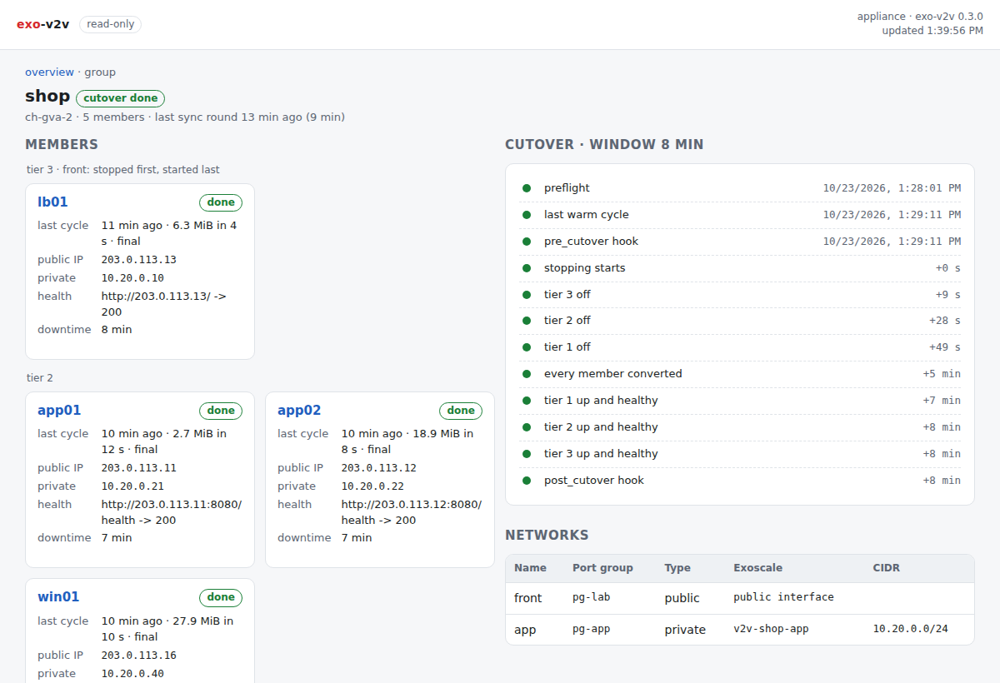

# Web status page

> **Experimental.** exo-v2v 0.4.0 is an early release, validated in one lab (ESXi 7.0 U3 to Exoscale ch-gva-2). Try it on non-critical VMs first; commands and behaviour may change.

`exo-v2v web` serves a read-only page with the state of every migration and
group on the replication appliance: phases, the last cycles, cutover steps,
downtime, member logs. Share it with the people who follow a migration without
giving them a shell.

```bash
sudo -E exo-v2v web                      # http://127.0.0.1:8780/
```

Run it as the user that runs the migrations (`sudo -E`, the same
`EXO_V2V_HOME`): it reads their state files.

## What it shows

| Page | Content |
|---|---|
| Overview | Groups (cutover state, members by tier and phase), every migration: phase, a sync or cutover running now, last cycle, public and private addresses, downtime |
| Migration | Phase, source VM, receiver, a chart of the data copied per cycle (full, delta, final), disks and where they go, networks with the Exoscale MACs, the cutover steps with their times, plan and preflight messages, events |
| Rehearsal | Its copies (phase, address, seed and boot times, health from the relay), its steps, networks, the names the copies tried to resolve, the TTL |
| Group | Members by tier with their health check results, the cutover steps (preflight, warm cycle, tiers off, conversions, tiers up, hooks) with their times, networks, a member's log, events |



The page refreshes every 5 seconds. It needs no internet access: no external
scripts, fonts or images.

## Read-only

- Only `GET` and `HEAD`; any other method gets `405`.
- It never writes a file and never takes a lock: a running sync or cutover is
  found from the process ID its lock file records.
- It needs no Exoscale or vSphere credentials, and serves no keys: the
  migration's SSH key and the tunnel's `known_hosts` are not exposed. Logs are
  served only for group members, by name.

## Access

It listens on `127.0.0.1:8780` by default. From your workstation:

```bash
ssh -L 8780:127.0.0.1:8780 appliance      # then open http://127.0.0.1:8780/
```

To listen on another address, set a token; the page refuses to start without one:

```bash
openssl rand -hex 24 | sudo tee /etc/exo-v2v-web.token >/dev/null
sudo -E exo-v2v web --listen 0.0.0.0:8780 --token-file /etc/exo-v2v-web.token
```

Open `http://appliance:8780/login?token=TOKEN` once: it sets an HTTP-only
cookie. API clients send `Authorization: Bearer TOKEN`. The page is plain HTTP:
put it behind a TLS reverse proxy, or keep the SSH tunnel, on any network you
do not trust. `EXO_V2V_WEB_TOKEN` can carry the token instead of a file.

## Run it as a service

```ini
# /etc/systemd/system/exo-v2v-web.service
[Unit]
Description=exo-v2v read-only status page
After=network-online.target

[Service]
Environment=EXO_V2V_HOME=/var/lib/exo-v2v
ExecStart=/opt/exo-v2v/bin/exo-v2v web --listen 127.0.0.1:8780
Restart=on-failure

[Install]
WantedBy=multi-user.target
```

## JSON API

| Path | Returns |
|---|---|
| `/api/overview` | Host, version, groups and migrations (summaries) |
| `/api/migrations/NAME` | One migration: plan, cycles, cutover steps, events |
| `/api/groups/NAME` | One group: members, cutover, networks, events |
| `/api/groups/NAME/log/VM?lines=N` | The last N lines (at most 2000) of a member's log |
| `/api/rehearsals/NAME` | One rehearsal: copies, relay, networks, steps, report |
